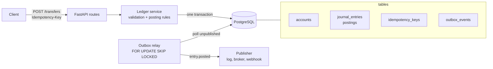

# ledgerline

A double-entry ledger API built with FastAPI and SQLAlchemy 2.

ledgerline records money movements the way accountants do: every journal entry
has at least two postings, and the postings must sum to zero in each currency.
Entries are immutable once posted; mistakes are corrected with reversing
entries. Transfers are idempotent, and every posted entry emits an
`entry.posted` event through a transactional outbox.

## Why

Most payment and wallet backends eventually need a ledger, and most early
ledgers are a single `balance` column updated in place. That loses history,
breaks under retries and makes reconciliation painful. This project is a small,
readable reference for the rules that make a ledger trustworthy:

- **Balanced by construction** — an unbalanced entry is rejected before it reaches the database.
- **Append-only** — history is never edited, so any balance can be recomputed as of any date.
- **Exactly-once effects over at-least-once networks** — `Idempotency-Key` on transfers.
- **No dual writes** — state changes and their events commit in one transaction.

## Architecture



| Module | Responsibility |
| --- | --- |
| `money.py` | Decimal to integer minor units per ISO 4217 currency, no silent rounding |
| `models.py` | Accounts, journal entries, postings, idempotency records, outbox events |
| `db.py` | Engine and session factory; a `before_flush` guard rejects edits and deletes of posted records |
| `service.py` | Posting rules, balances, reversals, idempotent transfers |
| `outbox.py` | Relay loop and the pluggable `Publisher` protocol |
| `api.py` | HTTP layer and error mapping |

## Quick start

With Docker (API, PostgreSQL and the outbox relay):

```bash
docker compose up --build
open http://localhost:8000/docs
```

Locally with SQLite:

```bash
python -m venv .venv && source .venv/bin/activate
pip install -e ".[dev]"
uvicorn ledgerline.main:app --reload
# in another shell, publish pending events to the log
ledgerline-relay
```

Configuration is read from the environment:

| Variable | Default |
| --- | --- |
| `DATABASE_URL` | `sqlite:///./ledgerline.db` |
| `RELAY_INTERVAL_SECONDS` | `1.0` |
| `RELAY_BATCH_SIZE` | `100` |

## API examples

Amounts are sent and returned as decimal strings. On postings, a positive
amount is a debit and a negative amount is a credit.

Create two accounts:

```bash
curl -s -X POST localhost:8000/accounts -H 'Content-Type: application/json' \
  -d '{"code": "1000-cash", "name": "Cash", "type": "asset", "currency": "USD"}'

curl -s -X POST localhost:8000/accounts -H 'Content-Type: application/json' \
  -d '{"code": "4000-sales", "name": "Sales", "type": "income", "currency": "USD"}'
```

Post a balanced journal entry:

```bash
curl -s -X POST localhost:8000/entries -H 'Content-Type: application/json' -d '{
  "description": "Invoice 1042 paid",
  "effective_date": "2026-01-15",
  "postings": [
    {"account_id": "<cash-id>",  "amount": "100.00"},
    {"account_id": "<sales-id>", "amount": "-100.00"}
  ]
}'
```

Transfer between accounts, safely retryable:

```bash
curl -s -i -X POST localhost:8000/transfers \
  -H 'Content-Type: application/json' \
  -H 'Idempotency-Key: 6f1c2a7e-transfer-001' \
  -d '{"from_account_id": "<a-id>", "to_account_id": "<b-id>", "amount": "25.00", "currency": "USD"}'
```

Repeat the same request and the original response comes back with
`Idempotent-Replayed: true`; no second entry is posted. Reusing the key with a
different body returns `422 idempotency_key_reused`.

Balance as of a date, and a reversal:

```bash
curl -s "localhost:8000/accounts/<cash-id>/balance?as_of=2026-01-31"
curl -s -X POST localhost:8000/entries/<entry-id>/reverse
```

### Endpoints

| Method | Path | Notes |
| --- | --- | --- |
| `POST` | `/accounts` | `type`: asset, liability, equity, income, expense |
| `GET` | `/accounts`, `/accounts/{id}` | |
| `GET` | `/accounts/{id}/balance?as_of=YYYY-MM-DD` | Balance in the account's normal direction |
| `POST` | `/entries` | At least two postings, sum zero per currency |
| `GET` | `/entries/{id}` | |
| `POST` | `/entries/{id}/reverse` | Posts the mirror entry; an entry can be reversed once |
| `POST` | `/transfers` | Requires `Idempotency-Key` header |
| `GET` | `/health` | |

Errors share one shape: `{"error": "unbalanced_entry", "message": "..."}`.

## Design decisions

**Integer minor units.** Postings store `amount_minor` as `BIGINT` with the
currency next to it. Decimal conversion happens only at the API edge, and an
amount with more precision than the currency allows (`1.005 USD`) is rejected
rather than rounded.

**Signed postings.** One signed column instead of separate debit and credit
columns keeps the balancing rule to a single `SUM(...) = 0` per currency.
Balances are reported in each account's normal direction: assets and expenses
are debit-normal, liabilities, equity and income are credit-normal.

**Immutability and reversals.** There are no update or delete endpoints, and a
session-level guard refuses to flush changes to posted entries or postings.
A reversal is a new entry linked through `reverses_id`, which carries a unique
constraint so two concurrent reversals cannot both succeed.

**Balances are derived.** A balance is the sum of postings up to an effective
date, which makes "balance as of" queries free and avoids drift between a
cached figure and history. A `(account_id, entry_id)` index supports the
aggregate; snapshotting balances per period is the next step at scale.

**Idempotency.** The key, a SHA-256 fingerprint of the request and the
response are stored in the same transaction as the entry. A retry replays the
stored response. If two requests with the same key race, the primary key on
`idempotency_keys` lets exactly one commit; the loser rolls back and replays the
winner's response. Validation failures are not stored, so a client can fix the
request and retry with the same key.

**Transactional outbox.** `entry.posted` is inserted into `outbox_events` in
the same transaction as the entry, so there is never an entry without an event
or an event without an entry. The relay reads pending rows in id order with
`FOR UPDATE SKIP LOCKED`, calls a `Publisher`, and marks rows published.
Delivery is at-least-once; consumers deduplicate on `event_id`. On a publish
failure the batch stops to preserve ordering, and the row records `attempts`
and `last_error`.

**Deliberately left out.** Multi-tenancy, authentication, FX conversion inside
an entry, migrations tooling (the schema is created on startup; Alembic is the
obvious addition) and a concrete broker publisher. The `Publisher` protocol is
one method, so Kafka, SQS or a webhook sender drops in without touching the
ledger.

## Running tests

```bash
pip install -e ".[dev]"
ruff check . && ruff format --check .
pytest
```

The suite runs against in-memory SQLite and covers money conversion, balancing
rules, as-of balances, reversals, immutability, idempotent replay and key
reuse, and outbox relay ordering and retry.

## License

MIT © 2026 Ahmed Mahdy
